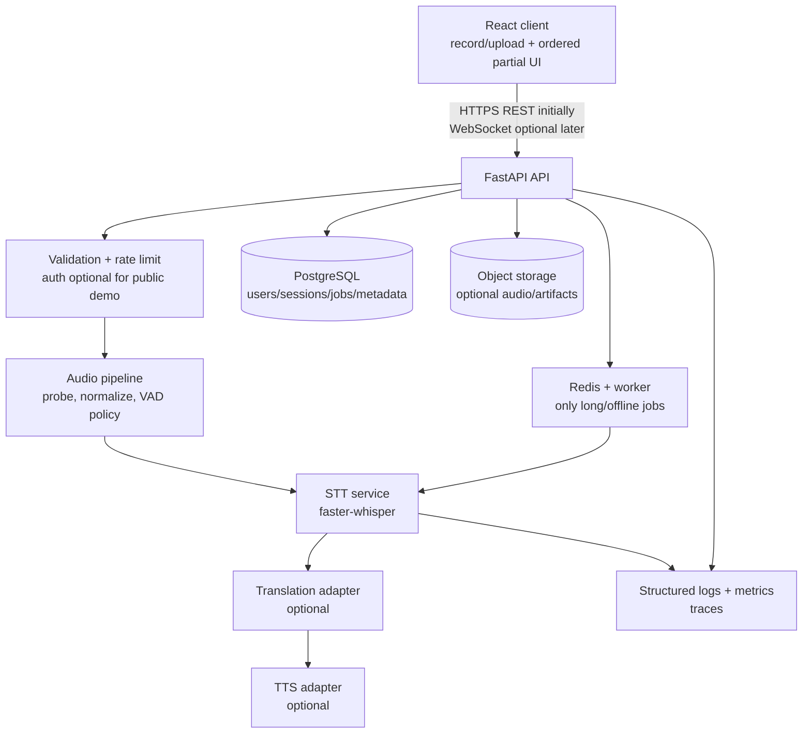

# Existing and Target Architecture

## Existing API surface

| Endpoint | Request | Response | Behavior |
|---|---|---|---|
| `GET /` | none | JSON message | Informational root. |
| `GET /health` | none | `{"status":"ok"}` | Liveness only. |
| `POST /api/model/warmup` | none | status/model settings | Lazily loads the model; may download it. |
| `POST /api/transcribe` | multipart `audio`, optional `language` | text/language/probabilities/duration/skipped | Saves temporary file and synchronously serializes model inference in a threadpool. |
| `POST /api/speak` | JSON `text`, optional `voice` | MP3 attachment | Calls Edge TTS, serves temp MP3, schedules delete. |

No WebSocket, session ID, upload ID, ordered sequence field, authentication header, pagination, persistence, or API version is present.

## Recommended portfolio-scale target

This is deliberately modular but not microservice-heavy. Begin as a modular FastAPI monolith plus a separate worker only after long jobs/persistence need it. Split inference into separate services only after measurements show contention or independent scaling needs.

| Component | Recommended technology | Responsibility | Mandatory? | Why |
|---|---|---|---|---|
| Web client | Existing React/Vite | Recording, client sequencing, transcript UX, playback. | Yes | Already suitable; add a typed API client and testable state. |
| API | FastAPI modular monolith | Auth, validation, short-request orchestration, OpenAPI contracts. | Yes | Existing competence and low operational cost. |
| STT inference | `faster-whisper` initially | Model lifecycle and transcription. | Yes | Retain until benchmarks justify a different model/runtime. |
| Audio pipeline | FFmpeg/PyAV-based controlled probe/normalization | Safe accepted formats, duration/sample rate/channel policy. | Yes for public uploads | Separates untrusted media parsing from route logic. |
| Translation adapter | NLLB/IndicTrans2 or managed API behind interface | Explicit source-to-target translations. | Optional | Add only for a defined multilingual product use case; evaluate quality/cost. |
| TTS adapter | Edge TTS prototype; configurable provider/self-hosted later | Voice allowlist, synthesis, retries, output handling. | Optional | TTS exists, but provider choice should be intentional and testable. |
| PostgreSQL | PostgreSQL + Alembic | Users, jobs, transcript metadata, evaluation runs. | Optional initially | Use when durable state/search/history is a feature; not for stateless demo. |
| Object storage | S3-compatible storage | Durable uploads/output, lifecycle rules. | Optional initially | Necessary only when retaining/reprocessing files; avoid local disks in replicas. |
| Background work | Redis + RQ/Celery/Arq | Offline/bulk long jobs with retries. | Optional | Not needed for 5-sec synchronous demo. Add when HTTP duration/retries demand it. |
| Streaming | WebSocket, binary PCM/Opus protocol | Partial/final events, cancellation/backpressure. | Optional advanced | A meaningful latency feature but protocol and test complexity are substantial. |
| Observability | JSON logging + Prometheus/OpenTelemetry | Latency, RTF, queue, errors, resource use. | Yes before public deployment | Makes engineering trade-offs measurable. |
| Deployment | Docker, Compose locally; one cloud container service | Reproducible runtime/config. | Yes for portfolio release | Demonstrates delivery without premature Kubernetes. |

### Model-routing guidance

Use one evaluated multilingual model first. Do not add model routing, a GPU service, Redis, Postgres, object storage, or a translation model merely to advertise technologies. Introduce each behind a stable interface and only after a use case and acceptance metric exist. For Telugu/Hindi/English and code-switching, build a held-out labelled set first; then compare Whisper sizes/compute modes and any Indic-focused candidate against the same WER/CER and latency protocol.
