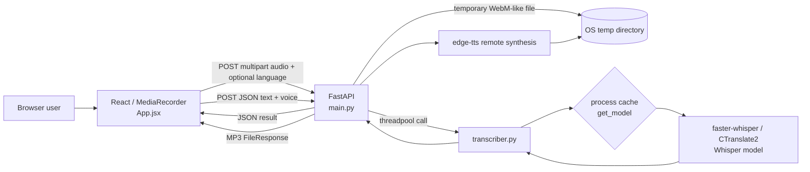

# Project Technical Audit — PeLocal Multilingual Speech

**Audit scope:** repository at Git `837a600` (working tree had a pre-existing modification to `README.md`; it was not changed).
**Method:** recursively inspected all 15 tracked project files, followed imports from the Vite entry point and FastAPI entry point, reviewed the available Git history, and performed non-inference API contract checks. No existing application code, dependencies, secrets, or runtime configuration values were modified.

## 1. Executive summary

This is a compact browser-to-FastAPI speech application, not yet a platform. It has a real, functioning implementation of microphone capture, 5-second *file-chunk* uploads, multilingual Whisper transcription with per-chunk language detection, VAD filtering, and server-side Edge TTS playback. It has no persistence, authentication, translation, WebSocket protocol, task queue, streaming ASR, automated tests, CI, deployment definition beyond a backend Dockerfile, or operational observability.

The strongest implemented idea is appropriate for a portfolio MVP: `faster-whisper` is loaded once per process (`get_model()` cache), while blocking inference is moved out of FastAPI's event loop. The main limitation is intentional serialization through `_transcribe_lock`; this protects a local model but gives one transcription at a time per process. Combined with independent 5-second recordings and unordered response appends, the current UI is near-real-time *batch chunking*, not real-time streaming and cannot guarantee a coherent continuous transcript.

The recommended next milestone is a reliable asynchronous upload API with validation, bounded resources, tests, metrics, and an honest measurement harness. Add translation and TTS hardening only after this stable STT baseline. WebSocket streaming, queues, PostgreSQL, and GPU serving are valuable later only when their concrete use cases arrive.

## 2. Repository structure and coverage

| Area | Files inspected | Findings |
|---|---|---|
| Root | `README.md`, `.gitignore` | Documentation describes STT accurately at a high level but has stale file names/defaults and omits TTS details. `.env`, virtual environments, build output and dependencies are ignored. |
| Frontend | `index.html`, `package.json`, lockfile, `vite.config.js`, `src/App.jsx`, `src/styles.css`, README | React 19/Vite single-page client. All behavior is in one component. |
| Backend | `app/main.py`, `config.py`, `transcriber.py`, `__init__.py`, requirements, Dockerfile, `download_model.py`, README | FastAPI application plus a small inference wrapper; no routers/services/tests. |
| Infrastructure | Dockerfile only | One backend image; no Compose, reverse proxy, IaC, CI/CD, health check instruction, or frontend deployment config. |
| Tests/data/schema | None tracked | No application tests, fixtures, benchmark corpus, database schema, migrations, or sample audio. |

The working directory contains ignored `backend/.venv` and `frontend/node_modules`; these were not treated as source. No project `.env` or Compose file was present at audit time. No file was excluded from the tracked-source review.

## 3. Existing architecture

**Frontend:** React 19, ReactDOM and Vite. `App.jsx` is both UI and client-side orchestration. It derives `API_BASE_URL` from `VITE_API_BASE_URL`, otherwise `http://localhost:8000`.

**Backend:** FastAPI 0.115.6 routes are declared directly in `app/main.py`; CORS permits configured origins. `run_in_threadpool` protects the async event loop from synchronous model inference. No service boundary, API version prefix, persistence layer, or dependency injection exists.

**External services:** model artifacts are acquired by `faster-whisper` when absent (or during Docker build); Edge TTS performs cloud synthesis. The latter means TTS is not self-hosted and requires outbound network availability. No database or object store is used.

## 4. Verified end-to-end execution flow

1. `App` starts with no model readiness state. Clicking **Start recording** calls `prepareModel()` (`App.jsx:54`) and blocks the UI while it POSTs `/api/model/warmup`.
2. `warmup()` calls `warmup_model()` (`main.py:50-55`), which materializes the cached `WhisperModel` using `Settings` (`transcriber.py:20-36`). The first use may download/load a model.
3. After `getUserMedia({audio: true})`, `recordSegment()` makes a new `MediaRecorder` around the same microphone stream (`App.jsx:193-240`). It records a discrete segment and stops it after `CHUNK_MS = 5000`.
4. The stopped recorder's parts become a `Blob`; `sendChunk()` rejects blobs below 1,000 bytes, then uploads `audio` as `chunk-<timestamp>.webm` and optionally a language form field (`App.jsx:150-190`). These are full upload requests, not audio frames on a persistent connection.
5. `/api/transcribe` accepts only a MIME type beginning `audio/`, copies the incoming file to an OS temp path with a UUID, checks the same 1,000 byte minimum, and deletes it in `finally` (`main.py:58-103`). It does not retain audio.
6. `transcribe_audio_file()` takes a process-wide `Lock`, invokes `WhisperModel.transcribe()` with `task="transcribe"`, optional language hint, VAD enabled, 700 ms silence threshold, 300 ms padding, beam size 1, and `condition_on_previous_text=False` (`transcriber.py:39-81`). There is no separate decoding, resampling, normalisation, denoising, or application-level segmentation code.
7. Segment text is concatenated. Whisper's `info.language` and `info.language_probability` are returned for that *chunk*. An English-only short-hallucination list may suppress text when average `no_speech_prob > 0.35`.
8. The browser appends each successful returned chunk to React state in response-arrival order and renders a whitespace-normalized concatenation. It does not merge overlaps, deduplicate boundary words, timestamp output, or impose chunk sequence order.
9. For TTS, `playTTS()` posts the combined text and selected voice to `/api/speak` (`App.jsx:78-127`). FastAPI calls `edge_tts.Communicate(...).save()` to a temporary MP3, returns it as a `FileResponse`, and schedules deletion as a background task (`main.py:105-130`). The browser plays the returned blob through `new Audio(url)`.
10. Errors show a message in the UI. Backend exceptions become 500 responses with the exception text in `detail`; validation failures use 400. Health only confirms that the web process answers, not model readiness or external TTS reachability.

### Format, language, and concurrency facts

The preferred browser MIME is `audio/webm`; if unsupported, `MediaRecorder` chooses a browser default but the upload filename still ends `.webm`. The backend trusts client MIME and file suffix; it has no allowlist or magic-byte verification. Frontend offers English, Hindi, Marathi, Tamil and Telugu hints plus auto-detect, but the API accepts any string. Auto-detect is Whisper's per-file language prediction—not separate LID nor session-level smoothing. Multiple HTTP requests can be in flight; backend inference is serial within a process and UI ordering is not protected.

## 5. AI/ML and speech analysis

| Component | Verified implementation | Why it is used | Limits / uncertainty |
|---|---|---|---|
| STT | `faster_whisper.WhisperModel` | A practical optimized Whisper inference wrapper supporting multilingual transcription. | Config defaults to multilingual `small`, CPU, `int8` (`config.py:5-7`). No empirical accuracy, model cache location, GPU benchmark or model artifact provenance is recorded. |
| Model lifecycle | `@lru_cache(maxsize=1)` in `get_model()` | Avoids model reload on each request. | Cache is only per Python process; multi-worker deployments multiply model memory. Model download/load failure is surfaced only at warmup/inference. |
| Voice activity detection | `vad_filter=True` with silence/pad parameters | Removes non-speech portions before decoding. | This is library-provided VAD configuration, not a separately evaluated pipeline; no tuning corpus or metrics. |
| Language detection | `info.language`, `info.language_probability` | Gives a no-extra-model language label for each chunk. | A chunk-level dominant-language prediction; not reliable evidence of code-switch recognition. A manual hint can override it. |
| Hallucination guard | `_SHORT_HALLUCINATIONS` plus average no-speech probability | Mitigates a few common silence artifacts. | English-centric, uncalibrated, and may discard genuine short speech; punctuation normalization is narrow. |
| TTS | `edge_tts` version constraint `>=7.0.0` | Fast implementation with named neural voices, returning MP3. | Cloud/provider dependent, not pinned, no voice catalog validation, no automatic voice/language selection, no retry/timeout or quality tests. |
| Translation | None | — | Neither frontend nor backend has a translation route, model, or external integration. |

GPU is optional only through manually supplied `WHISPER_DEVICE`/`WHISPER_COMPUTE_TYPE`; there is no hardware detection, compatible-setting validation, fallback, batching, quantization selection, or resource admission control. `beam_size=1` is an explicit speed/quality choice, but it is unmeasured in this project.

## 6. Critical technical findings

| Severity | Affected evidence | Finding and why it matters | Recommended resolution |
|---|---|---|---|
| High | `Dockerfile:16-18`; `config.py:5`; docs call out `base` | Docker downloads `base`, whereas runtime default is `small`. A default container therefore may download a second model at first warmup and carries an unused one. This breaks expected cold-start behavior and increases image/cost. | Define one typed configuration source and use it in `download_model.py`; test image startup with default settings. Prefer mounted model cache or explicit build arg rather than implicit mismatch. |
| High | `transcriber.py:9,40`; `main.py:91` | Every transcription is serialized by a global lock. Requests occupy worker threads while waiting; no queue length, timeout, or overload response exists. Latency rises unbounded under concurrent load. | Keep serialization initially but add bounded semaphore/queue, request limits and 429/503 behavior. Measure RTF; later isolate model workers or use a queue only if workloads justify it. |
| High | `App.jsx:171-181, 227-233` | Chunk results are appended when responses arrive, not sequence order; independent chunks have gaps/overlaps and no merge policy. The transcript can be reordered or duplicated under latency. | Carry a monotonically increasing sequence number, return it, buffer ordered commits, retain timestamps, and apply tested overlap/merge logic. |
| High | `main.py:63-73` | Client-controlled MIME and unbounded upload are trusted. There is no max size/duration, codec allowlist, content sniffing, or decode timeout—creating disk/CPU exhaustion exposure. | Enforce request body/file size at proxy and app, allowlist codecs, probe/decode safely, enforce duration, close uploads, and return non-leaky validation errors. |
| High | `main.py:105-130`; `App.jsx:17-23` | TTS is externally dependent but is presented as ordinary local capability. Voice selection accepts arbitrary names; text has no maximum; no provider resilience/rate control exists. | Explicitly configure the provider, allowlist supported voices, cap text, add timeout/retry/error taxonomy and rate limits. Document outbound-data/privacy behavior. |
| Medium | `main.py:93-100,126-130` | Raw exception text is returned to clients. It can reveal internals and creates an unstable API contract. | Log detailed exceptions with request IDs; return stable generic error codes/messages. |
| Medium | `main.py:18`; no logging setup | A logger is used but handlers, format, levels, correlation IDs, metrics, traces and retained operational events are absent. | Add structured logging, request IDs and Prometheus/OpenTelemetry metrics; avoid audio/transcript content by default. |
| Medium | `config.py`; route signatures | Settings and input are untyped/unvalidated strings. Invalid device, compute type, CORS, language and voice values fail late. | Use `pydantic-settings`, startup validation, request/response models, enum/allowlists and API versioning. |
| Medium | no `tests/`, CI, fixtures | No regression, contract, audio-pipeline, security, or benchmark tests exist. Claims of multilingual behavior and low latency are unsubstantiated. | Add unit/integration tests with licensed tiny fixtures and a reproducible benchmark dataset before feature expansion. |
| Medium | all routes | No authentication, authorization, rate limit, quotas, retention policy or consent notice. This is unsuitable for public deployment handling microphone audio. | For a public service: auth, per-user quotas, reverse-proxy limits, TLS, retention/deletion policy, and CORS restriction. Keep anonymous mode only as a local demo. |
| Medium | `requirements.txt:5` | `requests` has no import in tracked source; it adds supply-chain surface without use. | Remove after confirming it is not intentionally a direct operational dependency. Pin direct TTS dependency exactly after compatibility testing. |
| Low | `README.md:45,82`; `frontend/README.md:3`; `App.jsx:6` | Docs cite `App.tsx`, 2.5-second chunks and default `base`; source is `App.jsx`, 5 seconds and config default `small`. | Correct docs and add architecture/API contract documentation generated or tested against source. |
| Low | `App.jsx:17-23` | Label “Auto-Detect” maps to a fixed Hindi Edge voice, not automatic TTS voice selection. | Rename it or implement deliberate language-to-voice routing. |

## 7. Code quality, security, and production-readiness assessment

**Backend engineering:** routes and inference logic are small and readable, with temp-file cleanup and a threadpool boundary. They are nevertheless tightly coupled in one module. There are no response models, dependency-injected services, lifespan startup, health/readiness separation, uploads limits, versioned routes, or centralized error handlers. `BackgroundTasks` cleans TTS output after response completion, which is reasonable for this single-process demo but is not durable job processing.

**Speech engineering:** VAD, model caching and a silence guard show practical awareness. The pipeline relies entirely on library decoding; no sample rate/channel normalization, loudness normalization, noise suppression, speaker diarization, audio duration checks, boundary alignment, or code-switch strategy is implemented. The frontend's recorder segmentation means speaker audio around stop/start boundaries has no continuity guarantee. Accuracy and speed cannot be claimed without a corpus and measurements.

**Software quality:** code is concentrated and approachable, but no test harness, linting, formatting, type checking, pre-commit hooks or CI exists. The package lock contains stale root dev dependencies (`typescript`, React type packages) absent from `package.json`, a dependency-manifest drift worth reconciling. One UI display string is visibly mojibaked in source output (`App.jsx:334,346`), likely an encoding issue.

**Production readiness:** Docker uses a sensible slim Python base and non-cached pip install but runs as root, lacks a `HEALTHCHECK`, pins no base-image digest, and bakes/downloads model artifacts during build. There is no frontend production image, Compose configuration, secrets mechanism, reverse proxy, HTTPS, health/readiness split, autoscaling, queue, object storage, monitoring, alerting, backup, retention policy, or deployment pipeline. The application is suitable only for controlled local/demo use today.

## 8. Final engineering recommendations

1. Treat current scope honestly: “chunked multilingual STT demo with Edge TTS,” not a real-time speech platform.
2. Stabilize the STT contract, upload limits, ordering, configuration, error handling, and tests before adding models or infrastructure.
3. Measure WER/CER, real-time factor, percentile latency and memory on a declared machine/model/dataset; publish results and trade-offs.
4. Add translation only when there is a defined user journey (for example, transcribe Hindi/Telugu then produce English text). Do not infer translation merely from multilingual transcription.
5. Build a thin vertical slice for persistent jobs only once audio must outlive a request or work duration exceeds HTTP limits. PostgreSQL, Redis and object storage are then justified; they are not prerequisites for the MVP.
6. Make streaming a deliberate advanced phase: it needs framing, ordered partial/final protocol, cancellation, backpressure, observability and a model/latency evaluation—not only a WebSocket endpoint.

Detailed feature status is in [IMPLEMENTATION_MATRIX.md](IMPLEMENTATION_MATRIX.md); the actionable plan is in [UPGRADE_ROADMAP.md](UPGRADE_ROADMAP.md).
